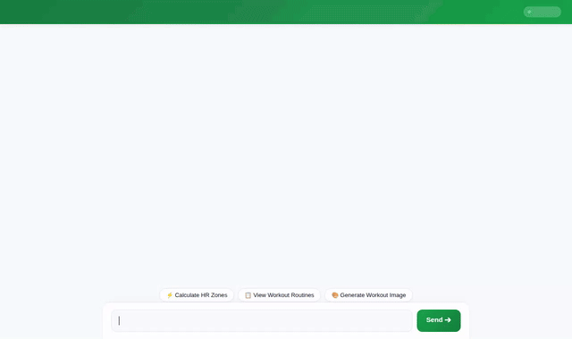

# Fitness Coach — Conversational AI Agent

A conversational AI agent built with Google's Agent Development Kit (ADK) that helps athletes and fitness enthusiasts calculate heart rate training zones, manage workout routines, track progress, generate workout visuals/videos, and retrieve real-time outdoor weather and nearby fitness facilities.



---

## Capabilities & Implemented Tools

The following capabilities are fully wired and implemented in `app/`:

* **Heart Rate Training Zones (`calculate_training_zones`)**: Computes personalized heart rate zones (Zone 1 Active Recovery through Zone 5 Max) using the Karvonen formula based on user age and resting heart rate.
* **Firestore Workout Management (`list_workouts`, `save_workout_routine`)**: Retrieves existing workout plans and logs new fitness routines directly into Google Cloud Firestore.
* **Long-Term Memory Bank (`VertexAiMemoryBankService`)**: Automatically remembers user health goals, fitness preferences, and food/dietary allergies across turns.
* **AI Image Generation (`generate_workout_visual`)**: Generates motivational fitness imagery using the `gemini-3.1-flash-lite-image` model in the `global` region, saving artifacts locally and uploading to Google Cloud Storage.
* **AI Video Generation (`generate_workout_video`)**: Generates short exercise demonstration videos using the `gemini-omni-flash-preview` model in the `global` region, saving artifacts locally and uploading to Google Cloud Storage.
* **Code Execution Sandbox (`AgentEngineSandboxCodeExecutor`)**: Safely executes Python code snippets in a isolated Agent Engine sandbox for complex calculations and pacing analytics.
* **A2UI Rich Surfaces (`A2uiSchemaManager`, `a2ui_callback`)**: Constructs structured cards using A2UI Schema v0.8 and Basic Catalog rendered natively in the frontend UI.
* **Outdoor Weather (`fetch_live_weather`)**: Fetches real-time temperature and wind conditions via Open-Meteo API for outdoor workout planning.
* **Geocoding & Nearby Places (`geocode_address`, `find_nearby_places`)**: Geocodes address locations and finds nearby gyms, parks, and fitness centers using Google Maps and Places APIs.

### Planned / Future Roadmap
* **Live GPS Route Tracking**: *Planned, not yet implemented.*
* **Wearable Health Sensor Sync**: *Planned, not yet implemented.*

---

## Google Cloud Architecture

* **Framework & Runtime**: Agent Development Kit (ADK) deployed on **Vertex AI Agent Engine / Agent Runtime** (`us-east1`).
* **Memory**: **Vertex AI Memory Bank Service**.
* **Database**: **Google Cloud Firestore**.
* **Media Storage**: **Google Cloud Storage** (`fitness-coach-media-qwiklabs-gcp-02-3bdea787ca30`).
* **Frontend Proxy**: **Google Cloud Run** service talking A2A protocol to Agent Runtime.

---

## Project Structure

```
fitness-coach/
├── app/
│   ├── agent.py          # Root agent definition, tool implementations, and A2UI instruction
│   └── a2ui_utils.py     # A2UI callback and surface sanitizer utilities
├── frontend/
│   ├── main.py           # FastAPI A2A proxy server
│   ├── requirements.txt  # Frontend python dependencies
│   └── static/
│       └── index.html    # Modern Fitness Coach web chat interface
├── assets/
│   └── demo.gif          # Looping demo recording
├── agents-cli-manifest.yaml  # Deployment manifest
└── pyproject.toml        # ADK project dependencies
```

---

## Local Setup & Run Instructions

### 1. Install Project Dependencies
```bash
uv sync
```

### 2. Run Agent Playground
Start the local ADK agent playground with Memory Bank integration:
```bash
uv run adk web . --port 8080 --reload_agents --memory_service_uri=agentengine://<AGENT_ENGINE_ID>
```

### 3. Run Web Chat Frontend
In a separate terminal, navigate to the `frontend/` directory and launch the proxy server:
```bash
cd frontend
pip install -r requirements.txt
export AGENT_ENGINE_RESOURCE_NAME="projects/<PROJECT_ID>/locations/<LOCATION>/reasoningEngines/<AGENT_ENGINE_ID>"
export AGENT_DIRECTORY="app"
python main.py
```
